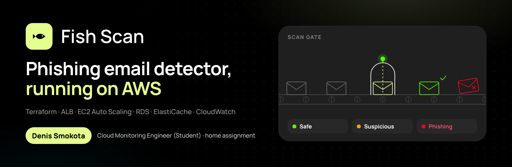

# Fish Scan: a phishing email detector on AWS

Fish Scan is a Python service that analyzes an email file, scores it for phishing indicators, and
returns a verdict.
Deployed on AWS with Terraform: a frontend and backend running on two EC2 instances behind an
Application Load Balancer, with scan history stored in RDS PostgreSQL and an optional result cache,
shared by both instances, on ElastiCache (Valkey).

## Evidence

Measured on the deployed stack on 14 and 15 November 2026. Times are UTC. The drills are numbered
after their screenshots. The raw notes are in [docs/screenshots/notes.txt](docs/screenshots/notes.txt).

- **Load test:** 600 requests, all 200, split 300 and 300 across the two instances; p50 423 ms and
  p95 591 ms at the client. [05](docs/screenshots/05-load-test.png)
- **Dashboard under load:** both targets healthy for the whole hour, about 300 requests a minute,
  server p50 about 40 ms. [06a](docs/screenshots/06a-dashboard.png),
  [06b](docs/screenshots/06b-dashboard.png)
- **5XX alarm, end to end:** 10 errors at 21:46, ALARM at 21:49:02 with an email, OK at 21:55:02
  with a second email. [07a](docs/screenshots/07a-alarms-all-ok.png),
  [07b](docs/screenshots/07b-target-5xx-history.png),
  [08](docs/screenshots/08-alarm-and-ok-emails.png)
- **Cache:** 96.6% hit ratio over 610 scans; 18.6 ms in the engine on a miss against 1.8 ms on a
  hit. [09](docs/screenshots/09-cache-hit-ratio.png)
- **Rejected traffic:** 6,868 rejected records in 3 hours; none reached an instance.
  [10a](docs/screenshots/10a-rejected-traffic.png),
  [10b](docs/screenshots/10b-rejected-traffic.png),
  [11a](docs/screenshots/11a-chrony-sources.png)
- **Drill 11, self-heal:** the service stopped on one instance; about 10 seconds of partial errors,
  instance replaced about 80 seconds after the failure, no manual action.
  [11b](docs/screenshots/11b-target-unhealthy.png),
  [11d](docs/screenshots/11d-unhealthy-targets-alarm.png),
  [11e](docs/screenshots/11e-curl-loop.png),
  [11f](docs/screenshots/11f-targets-recovered.png)
- **Drill 12, database unreachable:** scans still answered, History returned 503, `/health` stayed
  200 and no instance was replaced. [12a](docs/screenshots/12a-db-sg-before.png),
  [12b](docs/screenshots/12b-scan-not-saved.png), [12c](docs/screenshots/12c-history-503.png),
  [12e](docs/screenshots/12e-db-errors-logs.png)
- **Drill 13, drift:** `terraform plan` found the deleted rule (1 to add) and `apply` restored it.
  [13a](docs/screenshots/13a-terraform-drift-plan.png)
- **Drill 14, broken release:** the new instance failed its boot, the old one served throughout,
  and the refresh was cancelled and redone from `main`.
  [14a2](docs/screenshots/14a2-health-old-release.png),
  [14b](docs/screenshots/14b-refresh-inprogress-done.png),
  [14c](docs/screenshots/14c-boot-log-syntax-error.png),
  [14d](docs/screenshots/14d-asg-activity.png), [14e](docs/screenshots/14e-health-loop-200.png),
  [14f](docs/screenshots/14f-refresh-history.png),
  [14g](docs/screenshots/14g-refresh-successful.png)

## Repository layout

- [`app/`](app/): the Flask application; the detection engine is in
  [`app/detector/`](app/detector/)
- [`detect.py`](detect.py): the engine from the command line
- [`infra/base/`](infra/base/): VPC, RDS, the cache and the SNS topic, applied ahead of time
- [`infra/app/`](infra/app/): everything else: load balancer, instances, NAT gateways, monitoring
- [`deploy/user_data.sh.tftpl`](deploy/user_data.sh.tftpl): the instances' boot script
- [`scripts/load.py`](scripts/load.py): traffic generator for the dashboard and the 5XX alarm
- [`samples/`](samples/): 15 sample emails, phishing and legitimate
- [`tests/`](tests/): the test suite
- [`docs/security-scan.md`](docs/security-scan.md): every scanner finding and what was done with it
- [`docs/demo-runbook.md`](docs/demo-runbook.md): the checklist for the live demo
- [`docs/screenshots/`](docs/screenshots/): the evidence above, with the measured notes
- [`docs/design/`](docs/design/): the specs the project was built from, phase by phase, with the
  code standards
- [`BUILD_LOG.md`](BUILD_LOG.md): every problem met during the build, and how it was resolved

---

## 1. Overview

Fish Scan takes an email, as an uploaded `.eml` or `.txt` file or pasted as raw text, and says
whether it is Safe, Suspicious or Phishing, with the evidence behind the verdict: links whose text
and target disagree, lookalike sender domains, pressure wording, dangerous attachments. Every scan
is kept in a history, and an email seen before is answered from a shared cache with a count of how
often it has been seen.

The result page shows the verdict, the score, the rule that decided it, and the findings grouped by
category, each with its severity, its points, a one-line reason and the exact text that matched. The same analysis is
available as JSON on `/api/scan`, and from the command line with `detect.py`.

The application stack is not left running. `infra/app` is destroyed at the end of each working
session, and the demo brings it up again with Terraform (section 4).

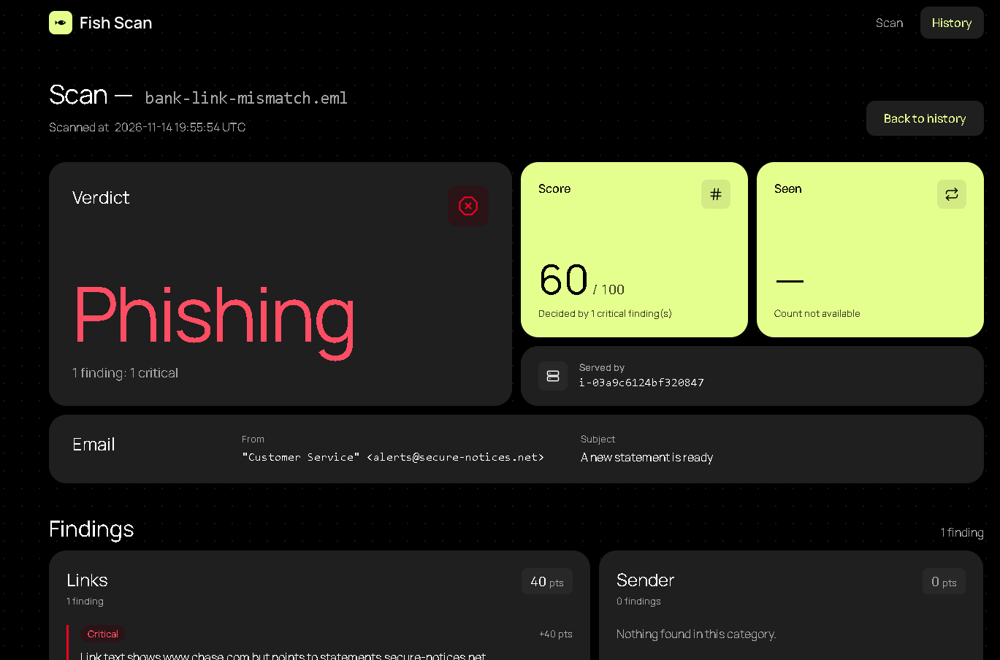

Also: [the Scan page](docs/screenshots/01-scan-page.png),
[a result served from the cache](docs/screenshots/03-result-cached.png),
[the History page](docs/screenshots/04-history.png).

The product is called Fish Scan; the repository and every technical identifier keep the original
name, `phishing-detector`: the Terraform resources, the log groups, the dashboard and the `Project`
tag.

## 2. Architecture

**Region:** `eu-north-1` (Stockholm), two availability zones.

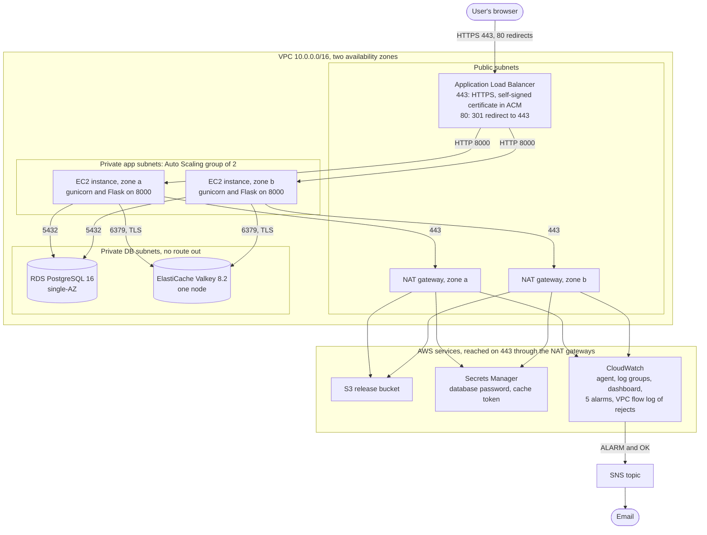

`infra/base` holds the VPC, the subnets, RDS, the cache, its secret and the SNS topic.
`infra/app` holds the rest: the load balancer and its certificate, the NAT gateways and their
routes, the instances, the release bucket, the IAM role, the security groups' rules, the log
groups, the dashboard, the alarms and the flow log.

**One request, from the browser to the result.**

1. The browser opens the load balancer's address on 443. TLS ends there, with the policy
   `ELBSecurityPolicy-TLS13-1-2-2021-06` (TLS 1.2 and 1.3). A request to port 80 gets a 301 to 443.
2. The load balancer forwards the request as plain HTTP on port 8000 to a healthy instance in
   either zone. It checks `GET /health` on each instance every 10 seconds.
3. On the instance, gunicorn (two workers) runs the Flask application as an unprivileged user. The
   upload stays in memory, capped at 5 MiB.
4. The application hashes the email (SHA-256) and asks the cache for a result stored under that
   hash and the current release, counting the sighting in the same round trip. On a hit it reuses
   the stored result and the engine does not run. On a miss the engine runs and its result is
   stored for a day. The cache is optional: when it is unreachable, scans carry on without it.
5. The scan is saved to RDS, marked with whether it came from the cache. The connection is
   encrypted (`sslmode=require`), and the password is read from Secrets Manager with the
   instance's role. If the database cannot be reached, the result is still shown, with a notice
   that it was not saved.
6. The page is returned with the security headers (section 7). The request is logged as one JSON
   line, which the CloudWatch agent ships to the log group `/phishing-detector/app`.

At boot, each instance downloads the release zip from S3, installs its dependencies from PyPI
through the NAT gateway in its own zone, and starts the service (`deploy/user_data.sh.tftpl`).

**The security group chain.** Each group admits only the one before it. Port 22 is open nowhere;
shell access is through Session Manager.

| Group | Inbound | Outbound |
|---|---|---|
| `phishing-detector-alb-…` | 443 and 80 from `allowed_ingress_cidrs` (default `0.0.0.0/0`) | 8000 to the app group |
| `phishing-detector-app-…` | 8000 from the load balancer's group | 443 to `0.0.0.0/0`; 5432 to the database's group; 6379 to the cache's group |
| `phishing-detector-db` | 5432 from the app group | none |
| `phishing-detector-cache-…` | 6379 from the app group | none |

The database's and the cache's groups belong to `infra/base`, which creates them empty. Their one
inbound rule each is created by `infra/app` (`security.tf`), and goes when that stack is destroyed.

## 3. The detection engine

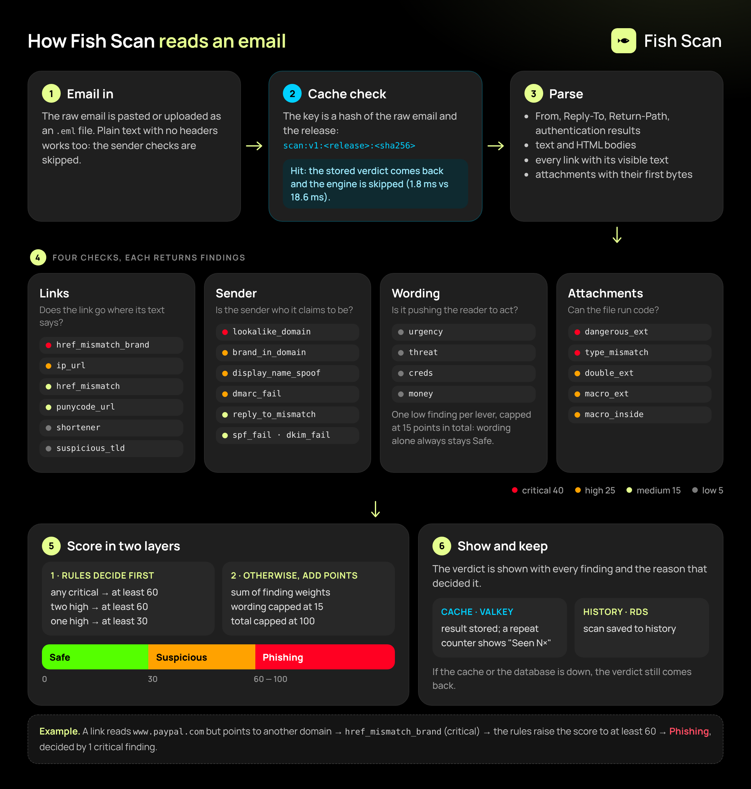

The same flow, step by step, is described below.

The engine is in `app/detector/`. Its entry point, `analyze()` in `engine.py`, is a pure function
of the email's bytes: no network calls, no configuration, no state. The same bytes always give the
same verdict. The web application and `detect.py` both call it.

**Parsing (`parse.py`).** The bytes become a `ParsedEmail`: the From display name and address,
Reply-To, Return-Path, Subject, Authentication-Results, the text and HTML bodies, every URL, the
visible text and target of each HTML link, and the attachments, held in memory. Input with neither
a From nor a Subject header is treated as plain text. Parsing never raises: whatever cannot be read
is left empty.

**The checks (`checks/`).** Four modules, one per category. Each reads the `ParsedEmail` and
returns findings; none does any I/O. A finding has a code, a severity, a one-line reason and the
evidence that matched. Domains are compared by their registrable domain, using the Public Suffix
List snapshot bundled with `tldextract`, which is never downloaded.

| Category | Findings (severity) | What is checked |
|---|---|---|
| Links | `href_mismatch_brand` (critical); `ip_url` (high); `href_mismatch`, `punycode_url` (medium); `shortener`, `suspicious_tld` (low) | a link whose text shows one domain and points to another, worst when the shown one is a brand; links to an IP address, punycode hosts, URL shorteners, and top-level domains common in abuse |
| Sender | `lookalike_domain` (critical); `lookalike_domain_fuzzy`, `brand_in_domain`, `display_name_spoof`, `dmarc_fail`, `non_ascii_domain` (high); `reply_to_mismatch`, `spf_fail`, `dkim_fail` (medium) | the From domain against a list of brands: character substitution (`paypa1`, `rnicrosoft`), a spelling within two edits, a brand's name inside another domain; a brand in the display name with a domain that is not the brand's; failures in Authentication-Results; a Reply-To or Return-Path in another domain |
| Wording | `urgency`, `threat`, `creds`, `money` (all low) | pressure phrases in the subject and the body, one finding per group of phrases |
| Attachments | `dangerous_ext`, `type_mismatch` (critical); `double_ext`, `macro_ext`, `macro_inside` (high) | the real extension, after removing direction controls and trailing dots; the first bytes against the extension; a VBA project inside an Office file. Nothing is written to disk or run |

Every list the checks use (brands and their own domains, known lookalikes that are legitimate,
shorteners, top-level domains, extensions, phrases, file signatures) is in `lists.py`.

**Score and verdict (`scoring.py`).** Two layers.

1. *The additive score.* A finding weighs 40 if critical, 25 if high, 15 if medium and 5 if low.
   Weights add up per category. Wording is capped at 15, so pressure words alone stay Safe. The
   total is capped at 100.
2. *The severity rules,* which can raise a verdict but never lower one. One critical finding lifts
   the score to at least 60. Two high findings do the same. One high finding with a score under 30
   lifts it to 30.

The verdict follows the score: 60 and above is Phishing, 30 and above is Suspicious, anything lower
is Safe. The result also says which rule decided (`decided_by`), and the score shown always matches
the verdict. Findings are listed by category, most severe first.

## 4. Running it

### Locally

The detection engine runs on its own, with no AWS account and no network access. It needs Python 3.12.

```bash
py -3.12 -m venv .venv                  # python3.12 -m venv .venv on Linux and macOS
.venv\Scripts\activate                  # source .venv/bin/activate on Linux and macOS
pip install -r requirements-dev.txt
```

`requirements-dev.txt` pins the development tools, `pytest`, `ruff`, and the scanners `bandit` and
`pip-audit`, and pulls in the runtime
dependencies from `app/requirements.txt`, so that one command sets up everything.

Analyse an email file:

```bash
python detect.py samples/paypal-phish.eml           # human-readable report
python detect.py samples/paypal-phish.eml --json    # the same result as JSON
```

The exit code carries the verdict: `0` Safe, `1` Suspicious, `2` Phishing, `3` if the file could not
be read.

Run the web application. It needs the local PostgreSQL container, which Docker runs from
`docker-compose.yml` together with a local Valkey for the cache:

```bash
echo DB_PASSWORD=localdev> .env         # once; .env is git-ignored, localdev is the database's password
echo CACHE_PASSWORD=localdev>> .env     # once; docker compose reads it for the cache container
docker compose up -d --wait             # PostgreSQL 16 on localhost:5432, Valkey 8.1 on localhost:6379
flask --app app.web run --port 8000     # then open http://127.0.0.1:8000
```

`docker compose` refuses to start until `.env` sets `CACHE_PASSWORD`, rather than run a cache that
accepts anyone. The scans table is created on first use. Without the database container the
application still starts and scans still work; results simply are not saved, and the history page
returns 503. `docker compose down` stops both containers and keeps the database's data.

The cache is off unless `CACHE_HOST` is set, so the application runs without it by default. To use
the local one, add to `.env`:

```bash
CACHE_HOST=localhost
CACHE_TLS=false                         # the local container has no TLS; ElastiCache has only TLS
```

Before every commit:

```bash
ruff format .
ruff check .
pytest -m "not integration"             # needs nothing running
```

The database and cache tests are marked `integration` and run against the containers: the
database tests in a separate `phishing_test` database so the local history is left alone, the
cache tests under keys of their own that they delete afterwards:

```bash
docker compose up -d --wait
pytest -m integration
```

### On AWS

You need Terraform 1.17 and the AWS CLI v2. Everything runs in `eu-north-1` with the CLI profile
`phishing`. There are no access keys: `aws login` issues temporary credentials that last 12 hours.

```powershell
aws login --profile phishing
```

**1. The base stack** holds the VPC, RDS, the cache and the SNS topic. It is applied once, ahead
of time, because the database and the cache each take about ten minutes to create.

Create `infra/base/terraform.tfvars` with the address that receives the alarm emails. The file is
git-ignored (`*.tfvars`):

```hcl
alert_email = "you@example.com"
```

```powershell
cd infra\base
terraform init
terraform plan
terraform apply
```

AWS then sends a subscription confirmation to that address. Click its link once. Under SNS →
Topics → `phishing-detector-alerts` → Subscriptions, the subscription must show **Confirmed**, not
PendingConfirmation; until then no alarm email arrives. The topic is in the base stack so that it is
confirmed once and outlives every apply of `infra/app`.

**2. The application stack** holds everything else:

```powershell
cd ..\app
terraform init
terraform plan
terraform apply
```

It reads the base stack's outputs from `infra/base/terraform.tfstate`, so it runs on the machine
that holds that file. The apply returns only once both instances pass the load balancer's health
check, and gives up after 12 minutes. A code change under `app/` makes a new release, and the next
`terraform apply` replaces the instances one at a time.

**3. The outputs to use** (`terraform output -raw <name>` in `infra/app`):

| Output | What it is for |
|---|---|
| `alb_url` | the service, on `https://` |
| `alb_http_url` | the same on `http://`, to test the redirect |
| `dashboard_url` | the CloudWatch dashboard |
| `asg_name` | the Auto Scaling group, to start or cancel an instance refresh |
| `target_group_arn` | for `aws elbv2 describe-target-health` |
| `release` | the release ID; `/health` reports the same value |
| `app_log_group`, `boot_log_group` | the application log and the boot log |
| `nat_public_ips` | the address each zone's instances appear from on the internet |
| `artifact_bucket`, `artifact_key` | the release zip in S3 |

**4. The certificate warning.** The certificate is self-signed (section 7), so a browser warns
before it shows the site: Advanced, then Continue. `curl` needs `-k`, and `scripts/load.py` needs
`--insecure`. Anything that uploads must use the `https://` address: a POST redirected from port 80
arrives as a GET and uploads nothing.

```powershell
$url = terraform output -raw alb_url
curl.exe -sk "$url/health"                                      # status, instance ID, release
python ..\..\scripts\load.py --url $url --insecure              # scans the samples, at most 5 a second
python ..\..\scripts\load.py --url $url --insecure --errors 10  # 10 deliberate 500s: fires target-5xx
```

## 5. Monitoring

One CloudWatch dashboard, `phishing-detector` (output `dashboard_url`), answers the five questions
the service must answer, one row each, with a row for the cache and a row of alarm status under
them. Everything is a managed AWS feature; nothing is self-hosted.

| Question | Metric or log | Where |
|---|---|---|
| 1. Are the instances healthy? | `HealthyHostCount` and `UnHealthyHostCount` of the target group; `GroupInServiceInstances`, `GroupPendingInstances`, `GroupDesiredCapacity` of the Auto Scaling group | row 1; alarm `unhealthy-targets` |
| 2. What are they consuming? | EC2 `CPUUtilization` and `CPUCreditBalance` (five-minute data); `mem_used_percent` and `disk_used_percent` from the CloudWatch agent | row 2; alarms `cpu-high`, `memory-high` |
| 3. How many requests reach the load balancer? | `RequestCount`, `RequestCountPerTarget` | row 3 |
| 4. Are requests succeeding? | `HTTPCode_Target_2XX/4XX/5XX_Count`, `HTTPCode_ELB_5XX_Count`, `TargetResponseTime` p50 and p95 | row 4; alarms `target-5xx`, `elb-5xx` |
| 5. Where are the logs? | log groups `/phishing-detector/app` and `/phishing-detector/boot`; the saved queries | row 5: latest errors, scans by verdict, and the list of saved queries |
| Is the cache working? | `CacheHits`, `CacheMisses`, `CurrConnections`, `DatabaseMemoryUsagePercentage`, `EngineCPUUtilization` | Cache row; no alarm, because the cache is optional |

The per-instance graphs use `SEARCH`, so they follow new instances after every deploy and
self-heal. They also show instances that were terminated inside the time range; a 1-hour range keeps
them readable.

**Alarms.** Five, all in CloudWatch → Alarms. Each emails through the SNS topic
`phishing-detector-alerts` when it goes to ALARM and again when it returns to OK. Missing data
counts as not breaching.

| Alarm | Metric | Fires when |
|---|---|---|
| `phishing-detector-unhealthy-targets` | `UnHealthyHostCount`, maximum | above 0 for 2 one-minute periods out of 2 |
| `phishing-detector-target-5xx` | `HTTPCode_Target_5XX_Count`, sum | 5 or more in one minute |
| `phishing-detector-elb-5xx` | `HTTPCode_ELB_5XX_Count`, sum | 5 or more in one minute |
| `phishing-detector-cpu-high` | `CPUUtilization` of the group, average | above 80% for 2 five-minute periods |
| `phishing-detector-memory-high` | `mem_used_percent` of the group, maximum | above 85% for 3 one-minute periods |

`unhealthy-targets` also fires during every deploy: a new instance is registered as it launches and
fails the health check until its boot ends (see *Decisions*).

**Log groups.** All three are created by Terraform in `infra/app`, so `terraform destroy` removes
them.

| Log group | Holds | Kept |
|---|---|---|
| `/phishing-detector/app` | the application's JSON lines, one stream per instance | 7 days |
| `/phishing-detector/boot` | each instance's boot log (`cloud-init-output.log`), one stream per instance | 7 days |
| `/phishing-detector/vpc-flow-rejects` | the VPC flow log, rejected traffic only, aggregated every 60 seconds | 3 days |

**Saved queries,** under CloudWatch → Logs Insights → Saved queries:

- `phishing-detector/errors`: the latest ERROR lines, with the path, status and error type
- `phishing-detector/verdicts`: scans by verdict
- `phishing-detector/requests-by-instance`: requests and average time per instance, health checks
  left out
- `phishing-detector/slowest-requests`: the 20 slowest requests
- `phishing-detector/cache-hit-ratio`: scans by cache result, with the time in the engine or the
  cache (`analysis_ms`) and the whole request (`duration_ms`)
- `phishing-detector/rejected-traffic`: the busiest rejected sources and the ports they tried

**What was measured.** Times are UTC, 14 November.

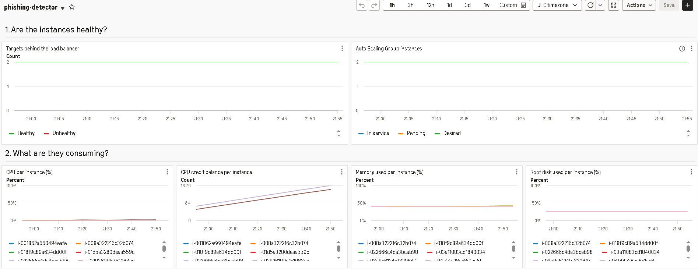

*Rows 1 and 2 at 21:58: 2 healthy targets and 0 unhealthy for the whole hour; CPU near 0% at about
5 requests a second; memory about 40%; root disk about 30%; the CPU credit balance rising.*

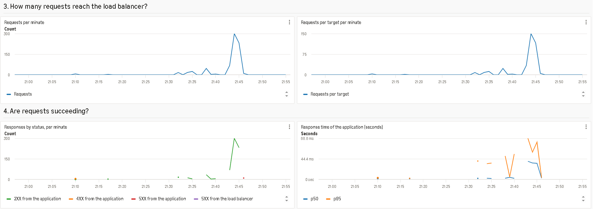

*Rows 3 and 4: the load test at 21:44, about 300 requests a minute, about 150 per target. 2XX up to
300 a minute; 10 application 5XX at 21:46 from `/simulate-error`; no 5XX from the load balancer
itself. Server response time p50 about 40 ms and p95 up to about 88 ms at the peak, against 423 ms
p50 at the client: the difference is the network and TLS.*

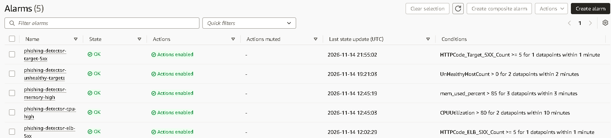

*The 5 alarms, all with actions enabled.*

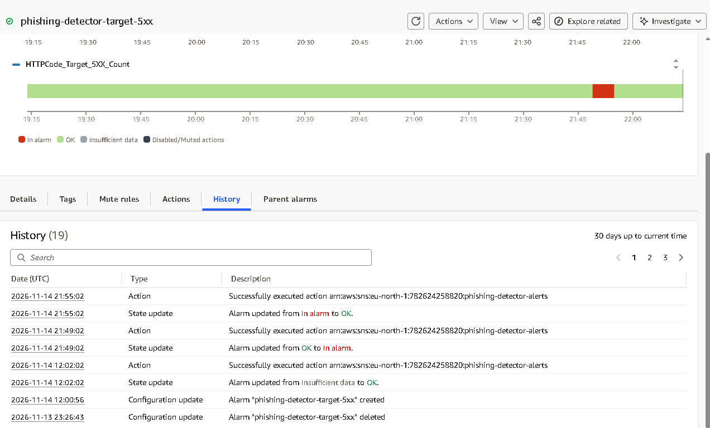

*`target-5xx`: 10 requests to `/simulate-error` at 21:46, ALARM at 21:49:02 (about 3 minutes of
metric delay), back to OK at 21:55:02.*

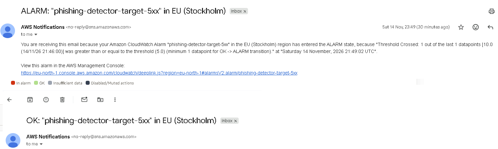

*The ALARM email at 21:49 and the OK email that followed.*

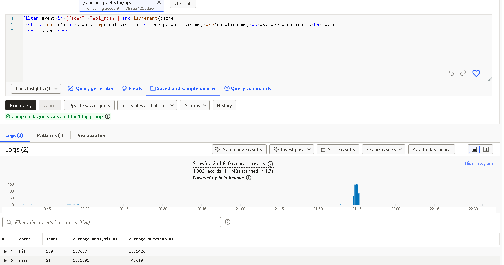

*`cache-hit-ratio` over the last 3 hours: 589 hits and 21 misses in 610 scans, a 96.6% hit ratio,
because the load test repeats a small set of samples. Time in the engine (`analysis_ms`): 18.6 ms on
a miss, 1.8 ms on a hit, about 10 times less. The whole request averaged 74.6 ms on a miss and
36.1 ms on a hit, but the miss average includes the first requests' warm-up (new database and cache
connections), so `analysis_ms` is the clean comparison.*

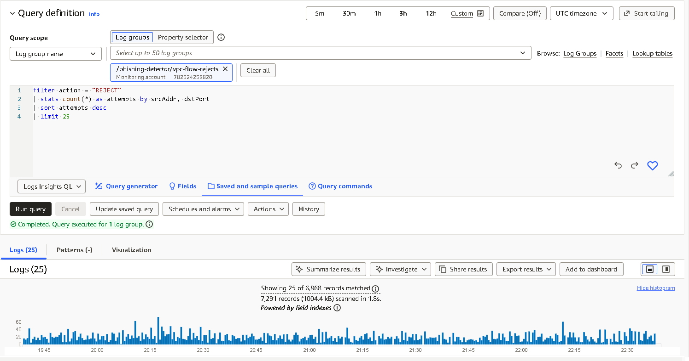

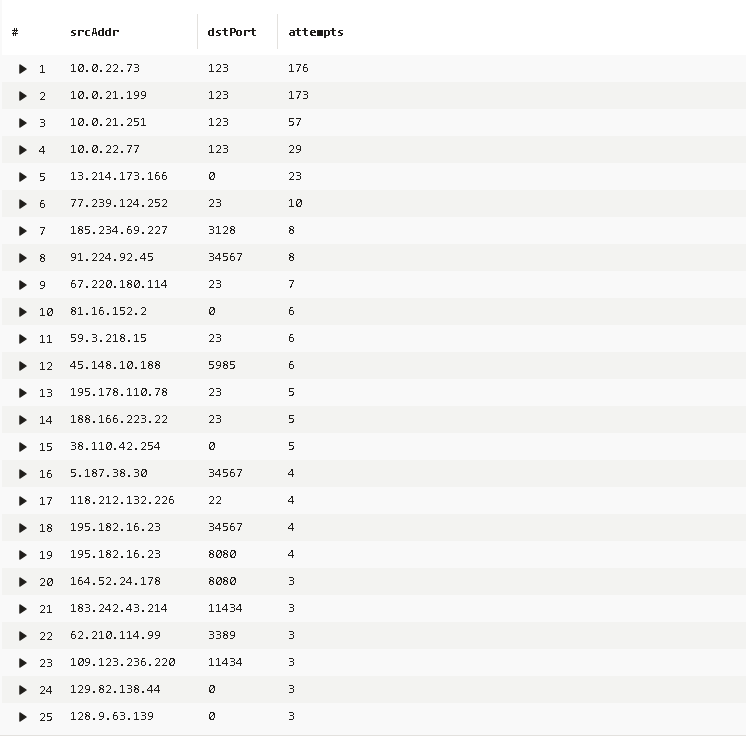

*`rejected-traffic` over the last 3 hours: 6,868 rejected records, the steady background of
internet scanning against the public load balancer and NAT addresses: Telnet 23, SSH 22, RDP 3389,
WinRM 5985, proxies on 8080 and 3128, DVR 34567, Ollama 11434, ICMP. None reached an instance. The
top 4 sources are the instances themselves (10.0.x.x) sending NTP (UDP 123) to public time servers,
which the egress rules block. Time still syncs through Amazon Time Sync at 169.254.169.123:
`chronyc sources` in drill 11 showed it selected, reach 377, offset about 10 µs, and the public
servers at reach 0 ([11a](docs/screenshots/11a-chrony-sources.png)).*

## 6. Troubleshooting runbook

**General approach.** Start from the symptom: the alarm, the email or what the user sees. Then find
the narrowest log or metric that explains it, usually one saved query or one log stream. Change one
thing at a time. Every fix goes through code, a Terraform apply or a new release; never edit a
running instance, because the Auto Scaling group replaces it with one built from the code. Write
every incident in `BUILD_LOG.md`.

The entries come from `BUILD_LOG.md` and the drills. A command marked *not run* was not run in
this project. The PowerShell commands run in `infra\app`. Times are UTC.

The health loop used in the drills, every 2 seconds:

```powershell
$url = terraform output -raw alb_url
1..150 | ForEach-Object { $r = curl.exe -sk -o NUL -w "%{http_code}" "$url/health"; "$(Get-Date -Format HH:mm:ss) $r"; Start-Sleep 2 }
```

### 6.1 Targets unhealthy

**Signal.** The `unhealthy-targets` ALARM email. On the dashboard, row 1 shows an Unhealthy line
above 0.

**Why it happens.** The load balancer calls `/health` every 10 seconds, and two failures in a row
mark a target unhealthy. `/health` touches neither the database nor the cache, so a failing target
means the process or the instance is down. With `health_check_type = "ELB"`, the Auto Scaling group
terminates the instance and launches a replacement, once its 300-second grace period is over.

**First look.** EC2 → Auto Scaling groups → `phishing-detector-app` → Activity: the cause of each
termination. Then EC2 → Target groups → `phish-…` → Targets, for the health reason.

**Likely causes.**

1. A deploy in progress. Each new instance fails the check until its boot ends. Confirm: an instance
   refresh is listed under the group's Instance refresh tab. Expected; it clears by itself.
2. The service stopped or crashed on one instance. Confirm: the Activity tab shows a termination for
   "ELB system health check failure", with a launch right after it.
3. A new instance that never becomes healthy: see 6.6.

**Fix.** For 1 and 2, nothing: the group replaces the instance. If it keeps happening, read the
instance's stream in `/phishing-detector/app` before the next replacement removes it.

**Verify.** Two healthy targets; the alarm's OK email; the health loop at `200`.

```powershell
aws elbv2 describe-target-health --profile phishing --target-group-arn (terraform output -raw target_group_arn)
```

**Observed (drill 11, 14 November).** `date -u; sudo systemctl stop phishing-app` over Session
Manager on `i-0c9cd0a423df923f0` (zone 1a) at 23:07:53. The loop got three 502s between 23:07:57 and
23:08:04, then only 200s through the instance in 1b: about 10 seconds of partial errors. The target
was marked unhealthy at about 23:08. The group terminated the instance at 23:09:16 for "ELB system
health check failure", about 80 seconds after the failure, and launched `i-09eed5b66ad2f9dd5` at
23:09:18. `unhealthy-targets` went to ALARM at about 23:10 and sent its email, and returned to OK a
few minutes later. No manual action. Screenshots:
[11b](docs/screenshots/11b-target-unhealthy.png),
[11d](docs/screenshots/11d-unhealthy-targets-alarm.png),
[11e](docs/screenshots/11e-curl-loop.png), [11f](docs/screenshots/11f-targets-recovered.png).

**Finding.** The instance was replaced in about 80 seconds, before anyone would have looked, and
nothing pages on an Auto Scaling replacement by itself. `unhealthy-targets` did fire, but it fires
on every deploy too, so it does not say that an instance was replaced. An EventBridge rule on Auto
Scaling events would (not built).

### 6.2 Application errors (target 5XX)

**Signal.** The `target-5xx` ALARM email: 5 or more 5XX answers from the application in one minute.
Row 4 shows the red line.

**Why it happens.** The application itself answered with an error. An unexpected exception gives a
500 and an ERROR log line with its type. `/history` and `/scans/<id>` answer 503 when the database
is unavailable. `/simulate-error` answers 500 on purpose, for the demo.

**First look.** Logs Insights → `phishing-detector/errors`, or the dashboard's "Latest errors"
widget.

**Likely causes.**

1. `/simulate-error` was called. Confirm: the `path` column.
2. The database is unreachable. Confirm: `history_unavailable` and `save_failed` lines. See 6.5.
3. A fault in a new release. Confirm: `error_type` and `error_message`, and whether the errors
   started with a deploy (the `release` that `/health` reports).

**Fix.** For 3, fix the code and apply; the new release replaces the instances one at a time. Never
patch the code on an instance.

**Verify.** No new lines in `phishing-detector/errors`; the alarm's OK email.

**Observed (14 November).** `python ..\..\scripts\load.py --url $url --insecure --errors 10`: 10
errors at 21:46, ALARM at 21:49:02 with an email, OK at 21:55:02 with a second email. On 13
November the same test brought the email 3 minutes after the errors. Allow about 3 minutes.
Screenshots: [07b](docs/screenshots/07b-target-5xx-history.png),
[08](docs/screenshots/08-alarm-and-ok-emails.png).

### 6.3 Load balancer errors (ELB 5XX)

**Signal.** The `elb-5xx` ALARM email: 5 or more 5XX answers from the load balancer itself in one
minute. Row 4 shows the purple line.

**Why it happens.** The load balancer could not get an answer from a target. It answers 502 when a
target closes the connection or is not listening, and 503 when it has no healthy target at all.

**First look.** EC2 → Target groups → `phish-…` → Targets. Then the Activity tab of
`phishing-detector-app`.

**Likely causes.**

1. The process on one instance stopped while it was still registered. Confirm: a few 502s, then
   one target unhealthy (6.1).
2. No healthy target: both instances down, or the first minutes after an apply. Confirm: 0 healthy
   targets in the target group.

**Fix.** For 1, nothing: the group replaces the instance. For 2, find why neither instance passes
the check (6.4 and 6.6).

**Verify.** The purple line gone from row 4; healthy targets in the target group.

**Observed.** In drill 11 the stopped process gave three 502s, between 23:07:57 and 23:08:04,
below the threshold of 5 a minute. During the load test the load balancer returned no 5XX of its own.

### 6.4 A deploy that does not boot

**Signal.** The `unhealthy-targets` email during a deploy that does not clear. The instance refresh
stays InProgress. In the Activity tab, the new instance is terminated for "ELB system health check
failure" and replaced, again and again. `/health` keeps showing the old release.

**Why it happens.** A new release changes the launch template, and the group replaces the instances
one at a time, keeping at least half of them healthy. The refresh waits 360 seconds after each
launch (the warm-up), longer than the 300-second grace period, so a replacement that cannot boot is
caught before the refresh moves on. The instance on the old release keeps serving.

**First look.** CloudWatch → Log groups → `/phishing-detector/boot` → the new instance's stream. A
boot that worked ends with `user_data finished OK (release …)`. If that line is missing, the last
command printed is the one that failed.

**Likely causes.** In boot order:

1. `aws s3 cp` answers 403: the read policy, or a missing key. Without `s3:ListBucket`, S3 answers
   403 for a missing object, never 404.
2. `pip install` hangs, then fails: no way out (NAT gateway, route or the 443 egress rule).
3. `compileall` fails: a syntax error in the release.

**Fix.** Stop the refresh, go back to the last good code, and apply:

```powershell
aws autoscaling cancel-instance-refresh --profile phishing --auto-scaling-group-name (terraform output -raw asg_name)
git switch main
terraform apply
```

**Verify.** The new refresh ends Successful; two healthy targets; `/health` reports the release in
`terraform output -raw release`.

**Observed (drill 14, 15 November).** Release `19236e29cae8` from the `drill/broken-release` branch,
which adds `app/drill_broken.py` with a syntax error, was applied at about 00:33. The refresh took
out one instance and launched a new one, which failed at `compileall` with a `SyntaxError` in
`drill_broken.py` (for example `i-0d1a0c4915ec681ee` at 00:39:56, about 63 seconds after boot); the
service never started. After the 300-second grace period the group replaced each new instance for
"ELB system health check failure": `i-0390cd098a8312c14` at 00:38:47 and `i-0d1a0c4915ec681ee` at
00:44:53, a cycle of about 6 minutes. The refresh never touched the second instance
(`i-0677fa06e36629c91`, release `c8a378517277`), and the health loop stayed at 200 throughout. The
refresh was cancelled at 00:48:48 ("Cancelled due to user request"); `git switch main` and
`terraform apply` put back release `c8a378517277` (an identical source hash), and the new refresh,
started at 00:52:18, was Successful at 01:09:19. Screenshots:
[14a2](docs/screenshots/14a2-health-old-release.png),
[14b](docs/screenshots/14b-refresh-inprogress-done.png),
[14c](docs/screenshots/14c-boot-log-syntax-error.png),
[14d](docs/screenshots/14d-asg-activity.png), [14e](docs/screenshots/14e-health-loop-200.png),
[14f](docs/screenshots/14f-refresh-history.png),
[14g](docs/screenshots/14g-refresh-successful.png).

**To repeat it.** The `drill/broken-release` branch holds the broken release. It is never merged.

**What production adds.** Automatic rollback of the instance refresh on a dedicated alarm, for
example on 5XX or on failed boots. Not on `unhealthy-targets`, which fires on every normal refresh
and would roll every deploy back.

### 6.5 Database unreachable

**Signal.** A scan shows its result with a notice that it could not be saved. History returns 503.
If enough requests fail, `target-5xx` fires, since each 503 counts. `/health` stays 200, and no
instance is replaced.

**Why it happens.** `/health` does not touch the database, on purpose: a database outage must not
make the group replace healthy instances. A circuit breaker in `app/db.py` keeps the outage from
piling up requests: after a connection fails (3-second timeout), each process fails every database
call at once for 15 seconds, then lets one attempt through.

**First look.** Logs Insights → `phishing-detector/errors`: `save_failed` and
`history_unavailable` lines with the error type. Each process also logs one `db_circuit_open`
warning.

**Likely causes.**

1. The inbound 5432 rule on the database's security group is gone. Confirm: EC2 → Security groups
   → `phishing-detector-db` → Inbound rules should hold one rule, 5432 from
   `phishing-detector-app-…`; `terraform plan` in `infra/app` shows it to be created.
2. The database is not available. Confirm: RDS → Databases → `phishing-detector-db`, its status.
3. The application cannot connect for a reason of its own. Confirm: the error message. On 13
   November `ProtectHome=true` made `/home` unreadable to the service, and libpq aborted every
   connection with "Permission denied" on a client certificate file; the message named the file
   (`BUILD_LOG.md`).

**Fix.** For 1, `terraform apply` in `infra/app` (6.9). For 3, a change to the code or the boot
script, through a new release.

**Verify.** A new scan is saved; History answers again. Allow about 15 seconds after the fix, the
breaker's window.

**Observed (drill 12, 15 November).** The 5432 rule from the app group was deleted in the console
at about 00:00. Scans still returned a verdict, with "could not be saved"; History returned 503. The
health loop stayed at 200, both targets stayed healthy, and the group replaced nothing. The log
showed database connection errors and one circuit-breaker warning; after the first 3-second
connect timeout, requests failed fast. `terraform apply` restored the rule at about 00:12, and saving
and History worked again within about 15 seconds. Screenshots:
[12a](docs/screenshots/12a-db-sg-before.png), [12b](docs/screenshots/12b-scan-not-saved.png),
[12c](docs/screenshots/12c-history-503.png), [12e](docs/screenshots/12e-db-errors-logs.png).

### 6.6 An instance that never becomes healthy after launch

**Signal.** The apply fails after 12 minutes with "want at least 2 healthy instance(s) registered to
Load Balancer, have 1", and the Auto Scaling group is tainted. The Activity tab shows terminations
at a regular interval.

**Why it happens.** A new instance is protected for its 300-second grace period. If its boot takes
longer, or never finishes, the group replaces it, and the replacement meets the same fate.

**First look.** CloudWatch → Log groups → `/phishing-detector/boot` → the instance's stream. The
CloudWatch agent starts first in the boot, so the rest of the boot is visible there, without
connecting to an instance that is about to be replaced.

**Likely causes.**

1. The boot is slower than the grace period. Confirm: terminations every few minutes, and an
   `Up … seconds` line in the boot log longer than 300.
2. Nothing in the boot log group at all: the boot died before the agent started, at
   `dnf install`. This is the one case that needs Session Manager.
3. A failure later in the boot: `aws s3 cp`, `pip install` or `compileall` (6.4).
4. The boot log ends with `user_data finished OK`, but the target is still unhealthy: the service
   started, then stopped. Confirm on the instance with `journalctl -u phishing-app -n 50` (*not run*).
5. In a new account only: the first apply fails to assume `AWSServiceRoleForAutoScaling` while that
   role propagates. Apply again.

**Fix.** Through Terraform. To keep a broken instance up long enough to read it, apply once with
`terraform apply -var health_check_type=EC2` (*not run*), connect with Session Manager, then apply
again without the override. A second apply after a capacity timeout replaces the tainted group;
that is expected.

**Verify.** The boot log ends with `user_data finished OK (release …)`, and the apply completes.

**Observed (BUILD_LOG, 14 November).** The first apply of the HTTPS and NAT change timed out after
12 minutes. The Activity tab showed an instance terminated about every four minutes: 12:05, 12:09,
12:13 and 12:17. The grace period was 180 seconds and the boots took 203 to 298 seconds. The cause
was `cpu_credits = "standard"`: a new instance started with no credits and booted at its baseline.
Grace period 300 and warm-up 360, then `cpu_credits = "unlimited"`, fixed it; the next boot took 76
seconds.

### 6.7 High CPU or memory

**Signal.** The `cpu-high` email (average CPU above 80% for 10 minutes) or the `memory-high` email
(an instance above 85% memory for 3 minutes).

**Why it happens.** Each `t3.micro` runs two gunicorn workers. CPU credits are set to `unlimited`,
so an instance that has used its credits is not throttled: it keeps running, and the surplus is
billed.

**First look.** The dashboard, row 2 (CPU, CPU credit balance, memory, disk per instance), then
row 3 for a surge in requests.

**Likely causes.**

1. A surge of requests. Confirm: row 3.
2. Sustained bursting. Confirm: a CPU credit balance that stays at 0.
3. Memory growing on one instance. Confirm: one line climbing on the memory graph.

**Fix.** For 3, replace the instances with an instance refresh (*not run*):

```powershell
aws autoscaling start-instance-refresh --profile phishing --auto-scaling-group-name (terraform output -raw asg_name)
```

For a lasting increase in load, a larger `instance_type` through Terraform (*not run*).

**Verify.** The alarm's OK email.

**Observed.** Not drilled. Under the load test, at about 5 requests a second, CPU stayed near 0%
and memory about 40% ([06a](docs/screenshots/06a-dashboard.png)). On 14 November a credit balance
at 0 on new instances explained the slow boots in 6.6.

### 6.8 An alarm fired, but no email arrived

**Signal.** An alarm is in ALARM in the console, and nobody received an email.

**Why it happens.** An email subscription to SNS delivers nothing until someone clicks the link in
its confirmation email. Terraform cannot click it. That is why the topic lives in `infra/base`: it
is confirmed once and outlives every apply of `infra/app`.

**First look.** SNS → Topics → `phishing-detector-alerts` → Subscriptions: the status.

**Likely causes.**

1. The status is PendingConfirmation.
2. The email went to spam.
3. The alarm's actions are disabled. Confirm: CloudWatch → Alarms, the Actions column.

**Fix.** Confirm the subscription from its email.

**Verify.** `python ..\..\scripts\load.py --url $url --insecure --errors 10`, then an email within
about 3 minutes.

**Observed.** Not seen in this project. Both emails arrived in the 5XX test
([08](docs/screenshots/08-alarm-and-ok-emails.png)).

### 6.9 Infrastructure drift

**Signal.** Something was changed by hand in the console, and the system no longer matches the
code. `terraform plan` shows changes when none were made in code.

**Why it happens.** Terraform compares the real account with the code and its state. A plan lists
any difference. It detects drift only in what its own stack manages: the database's 5432 rule is
managed by `infra/app` (`security.tf`), although the group belongs to `infra/base`, so the plan in
`infra/app` is the one that finds it.

**First look.** `terraform plan` in the stack that owns the resource.

**Likely causes.** A change in the console.

**Fix.** `terraform apply` puts back what the code says. If the hand change was right, write it into
the code instead.

**Verify.** `terraform plan` shows no changes.

**Observed (drill 13, 15 November).** After the rule was deleted in drill 12, `terraform plan`
reported "AWS resource not found during refresh", 1 to add, 0 to change, 0 to destroy.
`terraform apply` restored the rule at about 00:12. Screenshot:
[13a](docs/screenshots/13a-terraform-drift-plan.png).

### 6.10 Availability zone failure

Not drilled. What the design gives, with one NAT gateway per zone:

- **Keeps working.** The load balancer has a node in each zone. The instance in the surviving zone
  keeps serving, and keeps its own way out through the NAT gateway in its zone: it still reaches S3,
  Secrets Manager, CloudWatch and Session Manager, and a replacement instance can still boot.
- **Does not.** The database is single-AZ. If its zone fails, saving and History stop until it
  recovers; scans still return results (6.5). The cache is one node: if its zone fails, scans
  carry on without it. Until the failed instance is replaced, one instance carries all the traffic.

**Signal.** `unhealthy-targets`, and the database's symptoms if its zone is the one that failed.

**Fix.** Nothing in code; Multi-AZ RDS would cover the database (not built).

**What is not covered.** No paging or on-call rotation, no synthetic checks from outside AWS, no
automatic rollback.

## 7. Security

### Scans

Four scanners read the code: **checkov** (Terraform), **bandit** (Python), **pip-audit** (pinned
dependencies) and **gitleaks** (every commit). The goal is not zero findings but zero *unexplained*
ones: each is fixed, accepted with its reason written next to the code, or shown to be a false
positive. The full list, with what each check means, the risk, and what production would do, is in
[docs/security-scan.md](docs/security-scan.md).

- **checkov:** 36 findings. 4 fixed (VPC flow logs, and the three about plain HTTP, which went
  when the load balancer got HTTPS), 31 accepted, 1 false positive. Most of the accepted ones
  trace back to three decisions: a stack destroyed daily (so no deletion protection, short log
  retention), a demo-sized database, and a cache that is optional (so one node, and no rotation
  of its token).
- **bandit:** 2 low-severity false positives, both a variable name containing "password" or
  "token". No SQL is built from strings: every statement takes its values as parameters.
- **pip-audit:** no known vulnerabilities in the 29 pinned packages.
- **gitleaks:** nothing in the 10 commits of history on 13 November.

### Secrets

- **None in Git.** `.gitignore` excludes `.env`, `*.tfvars` and `*.tfstate*`. A pre-push hook runs
  gitleaks and blocks a push that contains a secret.
- **The database password** is generated, stored and rotated by RDS in Secrets Manager
  (`manage_master_user_password`). It never appears in a variable, the state or the instance.
- **The cache's AUTH token** is generated by Terraform and stored in Secrets Manager.
- **On the instance,** `/etc/phishing-app.env` (mode 0600) holds only the two secrets' ARNs. The
  application reads the values at runtime with its role. Two inline policies each allow
  `secretsmanager:GetSecretValue` on one secret's ARN; a third allows `s3:GetObject` on the release
  bucket's `releases/` prefix only.
- **No AWS access keys.** Local work uses `aws login`; the instances get their credentials from
  their role through the metadata service.

The hook lives in the repository, but where Git looks for hooks is local configuration and is not
cloned. Once per clone:

```bash
git config core.hooksPath .githooks
```

It uses `gitleaks` from `PATH`, or `tools/gitleaks.exe`. Without either it warns and lets the push
through.

### Network

- **IMDSv2 only** (`http_tokens = "required"`, hop limit 1): a request forged by the application
  cannot read the instance's credentials with a plain GET.
- **Private subnets.** The instances have no public address. The database and the cache sit in
  subnets with no route out of the VPC.
- **The security group chain** (section 2): internet → load balancer on 443 and 80 → instances on
  8000 → database on 5432 and cache on 6379. No port 22; shell access is through Session Manager.
- **Limited egress.** The instances may open only 443 to the internet, 5432 to the database and
  6379 to the cache. The flow log is the evidence: the instances' own NTP requests (UDP 123) to
  public time servers are rejected, while time syncs through Amazon Time Sync at 169.254.169.123
  (section 5).
- **Rejected traffic is logged:** a VPC flow log records every connection the security groups
  refuse; the saved query `phishing-detector/rejected-traffic` shows who probes, on which ports.

### TLS and HTTP

- **HTTPS on the load balancer,** with `ELBSecurityPolicy-TLS13-1-2-2021-06`: TLS 1.3 and 1.2,
  nothing older. Port 80 answers every request with a 301 to 443. Invalid header fields are dropped
  at the load balancer.
- **Encrypted inside AWS too:** the database connection with `sslmode=require`, the cache over TLS,
  and the release bucket under a policy that refuses non-TLS requests. EBS volumes, RDS storage, the
  cache and the bucket are encrypted at rest.
- **Security headers on every response:** a content security policy that allows only this origin's
  own files (`default-src 'self'; frame-ancestors 'none'; form-action 'self'; base-uri 'none'`),
  plus `X-Content-Type-Options: nosniff`, `Referrer-Policy: no-referrer` and
  `X-Frame-Options: DENY`. They are the second layer behind template escaping: if hostile markup
  from an email ever got through, the browser would still refuse to run it.
- **Stored XSS is tested, not assumed:** an email with script and image tags in its subject,
  sender, links and filename is shown escaped on the result and history pages.
- **Uploads stay in memory,** capped at 5 MiB, and are never written to disk. Attachments are
  inspected, never extracted or run.
- **`/simulate-error` is behind a switch:** see *Decisions*.

### The instance

The service runs under systemd as `phishing`, a system user with no home directory and no login
shell. The unit sets `NoNewPrivileges=true`, `PrivateTmp=true`, `ProtectSystem=full` and
`ProtectHome=tmpfs`. The code is owned by root and read-only to the service user.

### Accepted limitation: the self-signed certificate

There is no domain for this project, so no certificate authority will issue a certificate.
Terraform generates a self-signed one for the load balancer's DNS name and imports it into ACM. The
encryption is the same as with a trusted certificate; what is missing is proof of identity, so
browsers warn. Its private key is in Terraform state, which is local and git-ignored. There is no
`Strict-Transport-Security` header, because with a self-signed certificate it would lock browsers
out instead of letting the user click through. Production would use a domain, a certificate issued
by ACM whose key never leaves AWS, and HSTS (see *Decisions*).

### Running the scans again

checkov has its own virtualenv, so its many pins cannot change the project's:

```powershell
py -3.12 -m venv .venv-scan; .venv-scan\Scripts\pip install checkov==3.4.5
.venv-scan\Scripts\checkov -d infra --framework terraform --compact --quiet
bandit -r app scripts -q
pip-audit -r app\requirements.txt
gitleaks git . --redact --verbose
```

## 8. Cleanup

The order is always `infra/app` first, then `infra/base`. The application stack holds rules on the
database's and the cache's security groups, which belong to the base stack, and reads the base
stack's outputs. `infra/app` is destroyed at the end of each working session; `infra/base` stays up
until after the demo.

```powershell
cd infra\app
terraform destroy

cd ..\base
terraform destroy
```

The cache's secret is deleted at once, with no recovery window, so recreating the stack does not
trip over its name. RDS is destroyed without a final snapshot, on purpose. The AWS Budget was
created by hand outside Terraform, so it stays.

**How the teardown is verified,** in three steps.

1. **Terraform state is empty.** In each stack, this returns nothing:

   ```powershell
   terraform state list
   ```

2. **Nothing in AWS carries the project's tag.** Both providers apply
   `Project = phishing-detector` through `default_tags`, and the launch template copies the tags to
   the instances, volumes and network interfaces it launches. The tag API can go on listing
   terminated instances and deleted NAT gateways for a while; such an entry is only a concern if its
   own console shows it still `running` or `available`.

   ```powershell
   aws resourcegroupstaggingapi get-resources --profile phishing --tag-filters Key=Project,Values=phishing-detector --query "ResourceTagMappingList[].ResourceARN"
   ```

3. **No log groups are left.** The three log groups are all created by Terraform in `infra/app`:
   `/phishing-detector/app` and `/phishing-detector/boot` in `logs.tf`, and
   `/phishing-detector/vpc-flow-rejects` in `flowlogs.tf`. The CloudWatch agent writes only into the
   first two, and RDS exports no logs, so `infra/base` creates none. All share one prefix:

   ```powershell
   aws logs describe-log-groups --profile phishing --log-group-name-prefix /phishing-detector --query "logGroups[].logGroupName"
   ```

All three should return empty lists. These narrower checks should be empty as well:

```powershell
aws cloudwatch describe-alarms --profile phishing --alarm-name-prefix phishing-detector --query "MetricAlarms[].AlarmName"
aws s3 ls --profile phishing | Select-String phishing-detector
aws elasticache describe-replication-groups --profile phishing --query "ReplicationGroups[?starts_with(ReplicationGroupId, 'phishing-detector')].ReplicationGroupId"
aws secretsmanager list-secrets --profile phishing --include-planned-deletion --query "SecretList[?starts_with(Name, 'phishing-detector-cache')].Name"
```

After `infra/app` alone, `Key=Stack,Values=app` in place of the `Project` filter checks that stack's
part only.

**Teardown result (15 November).** `terraform destroy` in `infra/app` removed 57 resources at
about 01:15 UTC. Every verification check returned an empty list: the Terraform state, Auto Scaling
groups, EC2 instances, load balancers, NAT gateways, Elastic IPs and the `/phishing-detector` log
groups. `infra/base` stays up until the demo. Screenshot:
[15](docs/screenshots/15-destroy-verified.png).

---

## 9. Decisions and trade-offs

Every choice below was made deliberately. Where a cheaper or simpler option exists, it is named.

### Infrastructure

**Two Terraform stacks: `infra/base` and `infra/app`.**
`base` holds the VPC and RDS and is applied ahead of time, because RDS takes about ten minutes to
become available. `app` holds everything else and is applied live during the review in a few minutes.
`app` reads `base` outputs through `terraform_remote_state`.
*Trade-off:* two state files instead of one, and a dependency between them.

**`infra/app` finds `infra/base` through its state file, not by looking resources up by tag.**
`terraform_remote_state` reads the outputs of `base`'s local state file: the VPC, the subnets, the
database endpoint, the secret's ARN, the topic. The alternative is a data source per resource in `app`,
each finding its target by tag. That removes the dependency on the file, but it is more code, and it is
a second source of truth: the tags `app` searches for must stay in step with what `base` creates, and a
mismatch shows up as a lookup that finds nothing, or the wrong thing. The outputs are one explicit
contract instead.
*Trade-off:* `app` can only be planned on the machine that holds `base`'s state file, at the path it
expects, which suits a single operator and nothing larger. It also fixes the order: `base` is applied
before `app` and destroyed after it. With a team, both states would live in an S3 backend and
`terraform_remote_state` would read from there, with no other change.

**EC2 instances in private subnets, egress through a NAT gateway in each availability zone.**
The instances have no public IP and sit in private subnets with no route from the internet. The only
inbound path is from the load balancer's security group, on port 8000. There are no network ACLs
beyond the default. Outbound, each private subnet's route table points at the NAT gateway in its own
zone. If a zone fails, the instance in the other zone keeps its way out: it still reaches S3, Secrets
Manager, CloudWatch and Session Manager, and a replacement instance can still boot. The project
started with one gateway for both zones, to save cost; an availability review found that the
surviving instance would then have kept serving but could not have healed (see `BUILD_LOG.md`).
*Trade-off:* each NAT gateway costs roughly $1.10/day, plus about $0.12/day for its public address,
while the stack runs. What is still in one zone is the database: RDS is single-AZ, because Multi-AZ
doubles its cost and provisioning time, and a database outage degrades the service rather than
stopping it (see the RDS entry below).

**NAT gateways rather than VPC endpoints.**
In production the instances would reach AWS services through VPC endpoints instead: interface endpoints
for Session Manager, Secrets Manager, CloudWatch Logs and CloudWatch metrics, and a gateway endpoint for
S3. That traffic would then never leave the AWS network, and the instances would need no route to the
internet at all, which is the more secure pattern.
*Trade-off:* interface endpoints are billed per endpoint, per availability zone, per hour, and the
handful this project needs, in two zones, costs at least as much as the two NAT gateways. They would
also not remove the gateways: the instances install their Python dependencies from PyPI at boot, which
no endpoint reaches. For a four-day project the NAT gateways are the simpler way to the same working
system.

**Auto Scaling Group with min = max = desired = 2, one instance per AZ, `health_check_type = "ELB"`.**
This gives self-healing with no code: a failing instance is replaced automatically, which can be
demonstrated live by terminating one.
*Trade-off:* harder to debug than two fixed `aws_instance` resources, since a broken instance is
replaced before it can be inspected. For debugging, the stack can be applied with
`health_check_type = "EC2"`, so instances survive long enough to investigate.

**Chained security groups.**
`alb-sg` accepts :443 from the internet, and :80 only to redirect to it. `app-sg` accepts :8000 only
from `alb-sg`. `db-sg` accepts
:5432 only from `app-sg`. No security group admits traffic from a CIDR range except the load balancer's
listener, and port 22 is not open anywhere. Outbound, the instances are allowed :443 to the internet,
which is required for the AWS APIs and the package repositories.

**RDS PostgreSQL, `db.t4g.micro`, single-AZ, encrypted, not publicly accessible.**
*Trade-off:* the database is a single point of failure, while the application tier is spread across two
AZs. Multi-AZ doubles the cost and the provisioning time, which is not justified for a four-day
exercise. The failure mode is understood and handled: the health check does not touch the database,
so a database outage degrades the service rather than taking it down.

**A result cache on ElastiCache (Valkey 8.2), one node, in `infra/base`.**
The cache is shared by both instances, which is why it is a network service and not a dictionary in
each process: a request can land on either instance, and each has its own memory. It does two things.
The same email scanned again (many people forward the same phishing email to security) is answered
from the cache instead of being analysed again. And every scan increments a counter per email, shared
by both instances and expiring a day after the first sighting, so the result can say "Seen 14 times in
the last 24 hours": phishing arrives in campaigns, and that count is information for an analyst. Every
scan is still saved to the history, marked when it came from the cache.
- **What it does not give today is much speed, and the numbers say so.** The engine is offline and
  fast: on the 15 sample files it takes 3.5 ms on average and 18 ms at most (750 runs on a development
  machine). Most of a request is the network and the database write, which a hit still makes. Run
  locally against the Valkey container, 100 scans of the samples gave an average of 13.0 ms in the
  engine on a miss and 3.9 ms in the cache lookup on a hit, and the whole request took 57 ms on a
  miss and 55 ms on a hit: about 2 ms, or 4 percent, saved. On AWS, the saved query
  `phishing-detector/cache-hit-ratio` gave 18.6 ms in the engine on a miss and 1.8 ms in the cache
  on a hit, over 610 scans with a 96.6% hit ratio (section 5). The whole request averaged 74.6 ms on
  a miss and 36.1 ms on a hit, but the miss average includes the first requests' warm-up, so it
  overstates the saving. At the client, a load test after the cache went in gave p50 420 ms, about
  the same as before it (`BUILD_LOG.md`). The saving becomes real the day the engine does
  something slow, such as a reputation lookup or opening an attachment in a sandbox; nothing else
  would need to change.
- **Valkey 8.2**, the newest 8.x that ElastiCache offers in `eu-north-1` (7.2, 8.0, 8.1, 8.2, 9.0
  and 9.1 are offered). Chosen over 9.x because the 9 series is newer than the client library,
  redis-py, has been widely used against. The local container runs Valkey 8.1: 8.2 is an ElastiCache
  release, with no open-source image, and 8.1 is the closest.
- **The release is part of the key.** Any deploy changes the release, so nothing computed by an older
  version of the code is ever served; old entries simply expire. A stale verdict from a security tool
  is worse than a recomputed one.
- **Nothing is stored that the history does not already hold:** verdict, score, findings, sender and
  subject. The email body and attachments are never stored. The file name and `served_by` always come
  from the current request. A cached value is checked when it is read, and one that does not have the
  expected fields and types is deleted and treated as a miss.
- **It fails open.** A cache that does not answer within half a second is skipped, and after a failure
  each process leaves it alone for 30 seconds, logging one `cache_unavailable` warning rather than one
  per request. If its token cannot be fetched, the cache is left alone for five minutes. `/health` does
  not touch it, for the same reason it does not touch the database.
- **One node, no replica, no failover, no snapshots.** Unlike the database, losing the cache costs
  nothing but time: scans carry on, slower by a few milliseconds, and its contents are recomputed as
  scans come in. A replica in a second zone would double the cost of a component nothing depends on.
  The database is single-zone for a different reason: cost, although losing it does cost something.
- **The counter reveals that the same email was scanned before.** There are no accounts and the
  history is already public, so nothing new is exposed; with accounts, the count would be kept per
  organisation.

*Trade-off:* about $0.30 to $0.50 a day more for `infra/base` (see *Cost*), and a ten-minute create
when `infra/base` is applied, for a speed gain that is small today. The same cluster could carry a
per-address rate limit on uploads, the same mechanism as the sighting counter keyed by client
address; it is not built.

**Application code is delivered through S3.**
Terraform packages `app/` into a versioned zip, uploads it to a private bucket, and the instance's
`user_data` downloads it at boot. The zip is named after the hash of its contents, so a code change is
a new key, and that alone starts a rolling replacement of the instances. The instance role is allowed
`s3:GetObject` on the bucket's `releases/` prefix only: one key would have to be rewritten on every
release, while old and new instances coexist.
*Trade-off:* boot is slower than a pre-baked AMI, and the boot depends on PyPI for dependencies.
Alternatives considered: `git clone` (requires a token on the instance), ECR (an extra service),
a Packer-built AMI (a build step out of proportion to the project).

### Security and access

**No long-lived AWS credentials anywhere.**
Local development uses `aws login`, which issues temporary credentials valid for 12 hours; no access
keys exist on disk. EC2 instances receive credentials through an instance role over IMDSv2, which is
required (not optional) on the launch template. Nothing in the repository contains a key: `gitleaks`
found nothing in the history, and a pre-push hook runs it again before every push, once it is turned
on (see *Security*).

**The database password is never written down.**
RDS generates and rotates it (`manage_master_user_password = true`) and stores it in Secrets Manager.
The application reads it at startup and re-reads it if authentication fails, so rotation does not
require a redeploy. The password does not appear in Terraform variables, in state, or on the instance.

**The cache is encrypted in transit and at rest, and needs an AUTH token.**
TLS keeps the token and the results off the network in the clear, and the client verifies the
server's certificate and name; the token means that reaching the port is not enough to read the data.
Only the instances' security group may reach the port. Terraform generates the token and keeps it in
Secrets Manager; the instances read it with their role, on the first scan rather than at startup, and
the environment file holds only the secret's ARN.
*Trade-off:* the token is in `infra/base`'s Terraform state, which is local and git-ignored: the same
accepted demo trade-off as the self-signed certificate's key. It is not rotated, since rotating it
needs a coordinated change to the cluster and every instance. Production would use ElastiCache's IAM
authentication, where the application signs a short-lived token with its role and no long-lived secret
exists at all.

**Shell access through SSM Session Manager.**
No key pairs, no bastion host, no port 22 in any security group. Every session is authenticated and
authorized through IAM.

**AWS-managed policies for the two agents, hand-written policies for the data.**
The instance role attaches `AmazonSSMManagedInstanceCore` and `CloudWatchAgentServerPolicy`. They are
the documented requirements of the SSM agent and the CloudWatch agent, and rewriting them by hand means
guessing at a list of actions that AWS maintains and changes. Where the scope matters, reading the
releases in one bucket and one database secret, the permission is an inline policy written against
exactly that: one bucket prefix, one secret ARN.
*Trade-off:* the managed policies are broader than this project uses, and AWS can change them without
anything changing in this repository.

**HTTPS on the load balancer, with a self-signed certificate.**
The load balancer answers HTTPS on :443, with TLS 1.2 and 1.3 only, and :80 answers every request
with a 301 redirect to it. TLS ends at the load balancer: from there to the instances the traffic is
plain HTTP on :8000 inside the VPC, as before, so one place holds the certificate and the instances
did not change. There is no domain for this exercise, so no authority will issue a certificate.
Terraform generates a self-signed one, naming the load balancer's DNS name, and imports it into ACM.
The encryption is the same as with a trusted certificate; what is missing is proof of identity. So a
browser warns before showing the site (Advanced, then Continue), `curl` needs `-k`, and
`scripts/load.py` needs `--insecure`.
*Trade-offs:*
- **The certificate's private key is stored in Terraform state.** State is local and git-ignored, so
  the key never reaches git, but this is a demo trade-off. In production the certificate is issued by
  ACM against a real domain, and its private key never leaves AWS.
- **No `Strict-Transport-Security` header.** With a self-signed certificate, HSTS would make browsers
  refuse the site instead of letting the user click through the warning. With a real certificate,
  HSTS would be added.
- **A redirected POST becomes a GET.** Anything that uploads must be given the `https://` address
  (`terraform output -raw alb_url`); an upload posted to :80 is redirected and uploads nothing.

With a domain, this would be a Route 53 record and an ACM-issued certificate on the same two
listeners.

**Scans are viewable by id without authentication** (`/scans/<id>`), which is no new exposure because
`/history` already lists every scan publicly; a production deployment would require sign-in for both.

### Application

**A single Flask process serves both the UI and the API, on both instances.**
The assignment asks for "a simple frontend and backend running on two EC2 instances". Two identical
instances were chosen over one frontend instance and one backend instance, because identical instances
give real high availability: either one can fail without the service going down. Splitting the roles
would make each instance a single point of failure and leave the load balancer distributing traffic
across a target group of one.

**`/health` does not touch the database, or the cache.**
If the health check queried RDS, a database outage would mark both instances unhealthy at once, the
ALB would fail open, and the ASG could begin replacing healthy instances in a loop. Instead the
instances stay in service and the outage degrades the service rather than taking it down: a scan
still shows its result, with a notice that it was not saved, and the history page returns a friendly
503 that the 5XX alarm picks up.
*Trade-off:* the health check reports less than the full truth. The database is monitored separately
through its own CloudWatch metrics.
A shallow health check is not enough on its own, so a circuit breaker in `app/db.py` backs it: once a
connection to the database fails, each process stops trying for 15 seconds and every database call
fails at once, so requests cannot pile up behind the 3-second connect timeout, occupy both gunicorn
workers, and starve the load balancer's health check into replacing healthy instances. The production
alternative is threaded or asynchronous workers, so that a slow dependency cannot starve the health
check at all.

**One database connection per request, no pool.**
Each request opens a connection, with a 3-second connect timeout, and closes it when done. At the
traffic of a demo a pool solves no problem, and pooled connections can go stale across an RDS failover.
*Trade-off:* every database request pays for a new connection, a few milliseconds inside the VPC.
`psycopg_pool` would be a two-line change if the load ever justified it.

**Severity levels before additive scoring.**
Each finding carries a severity. One critical finding (a lookalike sender domain such as `paypa1`, an
executable attachment, a link whose text shows a brand domain but points elsewhere) is enough for a
Phishing verdict on its own. Two high findings reach the same verdict; one high finding guarantees at
least Suspicious. Everything else accumulates toward thresholds of 30 and 60.
*Rationale:* purely additive scoring is too forgiving of a single decisive indicator — a spoofed
domain alone would only reach "Suspicious", which is the wrong answer.
*Trade-off:* the weights and the severity assignments are tuned by hand against the sample corpus
rather than learned from data, which keeps them explainable.

**`/simulate-error` exists for the demo, behind a switch.**
The route answers with a deliberate 500, so that the 5XX alarm can be shown firing. Anyone who can
reach it can fire that alarm, so it is off by default: unless `ENABLE_ERROR_SIMULATION` is `true`, it
answers 404, exactly like an address that does not exist. `infra/app` switches it on for the review
(`enable_error_simulation`, default `true`). A production deployment would not have the route at all.
*Trade-off:* while the review stack runs, anyone can still fire the alarm; it is one variable to
turn off.

**The engine makes no network calls.**
No reputation APIs, no remote suffix-list downloads. The analysis is deterministic and the demo does
not depend on a third party being up.
*Trade-off:* no reputation data. A reputation lookup would be an optional, configuration-gated feature.

### Observability

**CloudWatch only, no self-hosted monitoring.**
The assignment asks to use managed AWS features rather than self-implementation. ALB, EC2, ASG and
RDS metrics come for free; the CloudWatch agent adds memory, disk and the application log. One
dashboard answers all the monitoring questions, and five alarms notify by email through SNS.
*Trade-off:* less flexible than Prometheus and Grafana, with nothing to operate or secure.

**Structured JSON logs.**
Each request is one JSON line. Logs Insights can then filter and aggregate by field instead of parsing
text.
*Trade-off:* less readable when tailing the file directly on an instance.

**Every resource is tagged, and the log groups are created in Terraform.**
A `default_tags` block tags everything with `Project = phishing-detector`, which is what makes the
post-teardown verification reliable. Creating the log groups explicitly means `terraform destroy`
removes them, rather than leaving orphans behind.

**The 5XX alarms count errors, they do not measure an error rate.**
Each fires at five errors in one minute. With demo-level traffic a percentage swings from 0 to 100 on
a single request, so a rate would be either silent or set off by one failure.
*Trade-off:* a fixed count does not scale with traffic. At production volume these would be error-rate
alarms built with metric math (5XX ÷ `RequestCount`), with a minimum request count.

**The unhealthy-target alarm fires during every deploy, and is left that way.**
A new instance is registered with the target group as soon as it launches, and fails the health check
for the minutes its boot takes. So each replacement sends one ALARM email and one OK
email. The alarm is telling the truth: capacity really is reduced for those minutes. It is kept this
sensitive so that a real failure is reported within two minutes.
*Trade-off:* expected emails on every deployment. The production answer is an Auto Scaling lifecycle
hook that registers an instance only once its boot has finished, or suppressing the alarm while a
deployment runs.

### Cost

Small instance types throughout (`t3.micro`, `db.t4g.micro`, `cache.t4g.micro`). `infra/app` is
destroyed at the end of each working day, so only `infra/base` runs overnight: RDS at roughly
$0.40/day, and the cache node, like RDS, around the clock. The design estimate for the node is $0.40
to $0.50 a day; ElastiCache prices Valkey nodes about 20 percent below Redis OSS ones, so it is likely
nearer the bottom of that. The price in `eu-north-1` was not checked in the console. The cache's
secret adds about $0.40 a month. An AWS Budget with email alerts was created manually, outside
Terraform, so that it survives `terraform destroy`.

While `infra/app` runs:

| | per day |
|---|---|
| 2 NAT gateways, one per zone | ~$2.20 |
| Load balancer | ~$0.60 |
| 2 × t3.micro | ~$0.50 |
| Public IPv4 addresses (two NAT gateways, two load balancer nodes) | ~$0.47 |
| **`infra/app`, running** | **~$3.77** |

The second NAT gateway and its address are about $1.22 of that: the price of each zone having its own
way out. The certificate costs nothing.

---

## 10. What I would do differently with more time

**A real domain and a trusted certificate.**
A Route 53 domain and a certificate issued by ACM on the same two listeners. The browser warning
goes, the private key never leaves AWS, and `Strict-Transport-Security` can be added.

**Automatic rollback on a dedicated alarm.**
Drill 14 needed a person to cancel the refresh and apply the previous release. The instance refresh
can roll back on its own when a named alarm fires. It needs an alarm of its own, on 5XX or on failed
boots: `unhealthy-targets` fires on every normal refresh and would roll every deploy back.

**Alerting on Auto Scaling replacements.**
In drill 11 the group replaced an instance in about 80 seconds, and nothing reported the
replacement as such. An EventBridge rule on the group's launch and terminate events, sent to the SNS
topic, would. A lifecycle hook that registers an instance only once its boot has finished would
also stop `unhealthy-targets` from firing on every deploy, so that it means something when it fires.

**Synthetic checks from outside AWS.**
Every check today runs inside AWS: the load balancer's health check and CloudWatch. A check from
outside, against the public address, would catch a failure on the way in, such as DNS or the
certificate, and would page someone. Paging and an on-call rotation are not covered either.

**Remote state with locking.**
Both states are local files, and `infra/app` reads `infra/base`'s from a fixed path. An S3 backend
with locking would let more than one person apply safely, and would take the cache token and the
certificate key off a laptop.

**A CI pipeline.**
On every push: `ruff`, the tests, the four scanners and `terraform plan`, and a gate that stops a
merge when they fail. Today they run by hand, and only gitleaks runs automatically, before a push.

**More boots measured before tuning the timers.**
Boots were measured at 118, 203 and 298 seconds with standard CPU credits, and 76 seconds with
unlimited ones. The grace period (300 s) and the warm-up (360 s) were left wide after the last
change; they should be lowered only after more boots have been measured. One measurement was not
enough the first time (`BUILD_LOG.md`, 14 November).

**Record IAM Access Analyzer's results.**
The four inline policies were written for least privilege, and checkov checked their shape, but the
results of IAM Access Analyzer against the live account are not recorded
([docs/security-scan.md](docs/security-scan.md), section 2).

**Match lookalike domains on visual confusability, not on edit distance.**
The engine flags a sender domain within two edits of a brand's domain. Edit distance counts how many
characters differ, but not whether the result could be mistaken for the brand, so it cannot tell
`payppal.com` from `apply.com`: both are one edit away from a brand. Tightening the threshold does not
help, since real typo-squats and ordinary words sit at the same distances. Today the damage is
contained rather than fixed: a near-spelling is only a high-severity finding, so on its own it yields
Suspicious and not Phishing, and an allowlist clears the common collisions.
The principled fix is a Unicode confusables mapping, such as the one published with Unicode Technical
Standard #39. An edit would count as suspicious only when the characters involved are visually
confusable: `rn` for `m`, `1` for `l`, a Cyrillic `а` (U+0430) for a Latin `a`. Swapping `g` for `o` would count
for nothing, and neither would the letters that separate `chess.com` from `chase.com`. That replaces a
measure of spelling with a measure of what a reader would actually misread, and it would make the
allowlist unnecessary.
*Trade-off:* confusability covers imitation that works on the eye, not squats that rely on a typing
slip. `goggle.com` is one of those, and it would need its own signal, such as keyboard adjacency.

**Verify the database's certificate, not only encrypt the connection.**
On EC2 the application connects with `sslmode=require`: the connection to RDS is encrypted or it is not
made, and RDS for PostgreSQL 16 refuses unencrypted connections on its side as well. What `require`
does not do is check who is at the other end. The production step is `sslmode=verify-full` with the
RDS certificate authority bundle shipped on the instance, so that the client also refuses a server
that cannot prove it is the database.

**Install dependencies by hash, not only by version.**
`app/requirements.txt` pins every package, the dependencies' own dependencies included, so every
instance installs the same versions. It does not pin the files: pip checks no hash, so a tampered
file on the index would be installed at boot. The fix is a lock file with hashes
(`pip-compile --generate-hashes`), installed with `--require-hashes`, or an image with the
dependencies already in it.

**Small changes to the database stack, left alone during the hardening pass.**
`infra/base` was not modified in phase 7, because a change there can modify or restart RDS. Two
cheap ones are worth making at the next planned apply: copying tags to snapshots, and setting
`auto_minor_version_upgrade = true` explicitly so the scanner stops reporting a default it cannot
see. Exporting the PostgreSQL log to CloudWatch would follow.

**Keep the exact error text.**
When the RDS API refused Performance Insights in phase 3, the message was not kept, and the build
log cannot quote it. Every refusal from an API should go into the build log word for word.
